# Modelo documental implementado por servicio

Base: `6bc8480`. Se modelan **16 colecciones usadas por el código**, en seis
bases, y dos tipos de línea **embebidos**, no colecciones independientes.
Los tipos BSON se infieren del mapping Spring Data y sus anotaciones; esta
actividad no inspecciona el contenido ni los índices de MongoDB en Windows.
Se omiten metadatos técnicos que el conversor pueda añadir, como `_class`.

PK señala `_id`, que tiene unicidad propia en MongoDB. UK señala un índice
único declarado/aprovisionado; no una clave foránea. Las uniones hacia líneas
representan documentos embebidos, no joins. `opcional` admite valor ausente/null
según el documento y su antigüedad. Date es un instante BSON en UTC; los ids
ObjectId se exponen como cadenas hexadecimales en HTTP.

## 1. Auth — auth_db

[Fuente Mermaid](03-modelo-auth.mmd) · [Clase Usuario](../../ms-auth/src/main/java/com/monpoint/auth/model/Usuario.java)

Una colección: usuarios. Índice único de correo y baja **lógica** con activo.
La auditoría de seguridad escribe logs, no una colección adicional de auditoría.
Se muestran los nombres BSON efectivos password_hash, creado_en y actualizado_en.
Difieren de contrasenaHash/fechaRegistro/fechaActualizacion y la baja física del
Documento 04; el diagrama registra esa divergencia, no cambia el esquema.

No se dibuja relación de usuarios hacia ventas: **Venta no guarda autor**.
Sembrar cuentas nominales no crea un histórico de ventas por cajero.

## 2. Inventario — inventario_db

[Fuente Mermaid](03-modelo-inventario.mmd) · [Clases](../../ms-inventario/src/main/java/com/monpoint/inventario/model/)

Dos colecciones: productos y eventos_procesados. Productos es la autoridad de
existencia y umbral. Nombre no es único y no hay campo código/SKU.
El descuento de una reserva exitosa y el marcador del evento comparten TX;
un rechazo revierte esa TX y registra después el marcador en otra.

Índices declarados: productos.activo y único eventos_procesados.eventoId.
Producto inactivo permanece en la colección; no se crea una colección de bajas.
No existe outbox implementado ni una colección separada de reservas.

## 3. Ventas — ventas_db

[Fuente Mermaid](03-modelo-ventas.mmd) · [Clases](../../ms-ventas/src/main/java/com/monpoint/ventas/model/)

Cinco colecciones: ventas, productos_replica, clientes_replica, contadores y
eventos_procesados. `lineas_embebidas` es el tipo de ventas.lineas; no añade
una sexta colección. Sus nombres y precios son snapshots, total es Decimal128,
folio es Int64 y contadores usa `_id: "venta_folio"` de tipo String.
No se guarda subtotal; se deriva al construir la respuesta.

clienteId y productoIdRechazado son ObjectId opcionales; los documentos
históricos pueden no incluir productoIdRechazado. No hay usuarioId/vendedorId.
Las réplicas conservan el id de origen; productos_replica no almacena stock y
clientes_replica solo almacena nombre/fecha, no sus contactos ni bajas físicas.

La creación automática de índices está apagada. El
[guion de provisión](../../infra/mongo-init/02-indices-ventas.js) crea:

| Colección | Índice adicional al de _id |
|---|---|
| ventas | folio único; (estado, fecha) y fecha descendente |
| productos_replica | activo |
| eventos_procesados | eventoId único |

**Desajuste conocido:** esos índices de fecha usan `fecha`, mientras Venta
persiste `fechaCreacion`/`fechaResolucion`. No se agrega un campo fecha al
modelo para esconderlo ni se cambia el índice desde esta actividad.
El [verificador](../../ms-ventas/src/main/java/com/monpoint/ventas/config/VerificadorDeIndices.java)
exige los de folio, estado y eventoId, pero no corrige ese desajuste.
No hay listado HTTP por fecha/estado en el backend actual.

## 4. Clientes — clientes_db

[Fuente Mermaid](03-modelo-clientes.mmd) · [Clase Cliente](../../ms-clientes/src/main/java/com/monpoint/clientes/model/Cliente.java)

Una colección: clientes. Índice no único sobre nombre. Correo no es único y no
existe activo. DELETE elimina físicamente; no publica un evento de baja.
Sus copias en ventas/reportes pueden seguir existiendo. Los ids compartidos son
trazabilidad de eventos, no integridad referencial ni cascadas entre bases.
No se modela proveedores porque no está implementado.

## 5. Reportes — reportes_db

[Fuente Mermaid](03-modelo-reportes.mmd) · [Clases](../../ms-reportes/src/main/java/com/monpoint/reportes/model/)

Cinco colecciones: configuracion, ventas_proy, productos_proy,
contrapartes_proy y eventos_procesados. `lineas_embebidas` pertenece a ventas_proy;
no es una colección. configuracion es propia y tiene `_id: "config"` String.
Las otras vistas de negocio provienen de eventos y usan el id del origen.
No se dibuja lectura HTTP ni acceso directo a la base de otro servicio.

ventas_proy solo recibe cierres CONFIRMADA/CANCELADA, no PENDIENTE. Su campo
fecha usa **fechaResolucion** del evento. Los totales/proyecciones no se
recalculan a partir del stock actual. No se persiste el importe derivado de línea.

La línea de reportes tiene **productoId String** en el mapping actual, sin
`@Field(targetType=OBJECT_ID)`; la línea de ventas sí lo declara ObjectId.
Se conserva esa diferencia en el dibujo en vez de copiar el tipo del Documento 04.
contrapartes_proy solo se alimenta como CLIENTE: no tiene ruc/razonSocial ni
un productor de proveedores. productos_proy no tiene existencia ni umbral.

Índices declarados: ventas_proy(fecha, estado), contrapartes_proy.tipo y
único eventos_procesados.eventoId. No se declara un índice único de folio en
ventas_proy por deducción del que sí existe en el servicio ventas.

## 6. Notificaciones — notificaciones_db

[Fuente Mermaid](03-modelo-notificaciones.mmd) · [Notificacion](../../ms-notificaciones/src/main/java/com/monpoint/notificaciones/model/Notificacion.java) · [Índices](../../ms-notificaciones/src/main/java/com/monpoint/notificaciones/config/IndicesNotificaciones.java)

Dos colecciones: notificaciones y eventos_procesados. No hay colección de
bitácora eventos usada por la implementación. El consumidor recibe solo
StockBajo, no VentaConfirmada/VentaCancelada. existenciaResultante representa
el evento recibido, no la existencia actual consultada al inventario.

| Índice explícito | Garantía |
|---|---|
| productoId único parcial, filtro activa=true | Como máximo un aviso activo por producto |
| (productoId, activa), no único | Consulta del aviso activo, permite historial de inactivos |
| leida | Filtro de lectura |
| eventos_procesados.eventoId único | Idempotencia junto con la TX del aviso |

Leer establece leida=true y activa=false; no repone stock. Un nuevo evento
puede crear otro aviso activo. La información del producto se conserva como
copia del evento, sin una FK que obligue a consultarlo en inventario.

## Alcance físico y relación con el Documento 04

Las 16 colecciones son el modelo utilizado por los seis servicios, no un censo
de todo MongoDB. El [guion de infraestructura](../../infra/mongo-init/01-crear-bases-y-usuarios.js)
crea además `_inicializacion` en cada base para hacerla visible: es un marcador,
no una entidad de negocio. Un volumen previo también puede conservar datos
históricos ajenos al recorrido actual. Ningún diagrama los borra ni garantiza
que cada instalación solo contenga estas colecciones.

El [Documento 04](../planeacion/MonPoint_MS_04_Modelo_de_Datos.pdf) y su
[transcripción](../modelo-datos/README.md) siguen como especificación de referencia.
Esta vista muestra las divergencias del código: auth en snake_case y con activo;
productoId de línea de reportes como String; campos de cancelación añadidos;
sin proveedores, outbox ni bitácora de cierres en Notificaciones. No reescribe
los PDF ni declara aprobada una migración del esquema.

Para seguir las copias por eventos: [producto](../eventos/producto.md),
[cliente](../eventos/cliente.md) y [cierre de venta](../eventos/venta-cierre.md).
No hay claves foráneas, DBRef ni consultas entre bases para completar esos datos.
